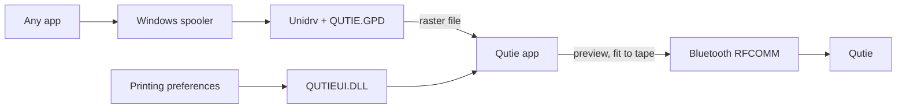

# Qutie driver for Windows

Print on the **HPRT Qutie** Bluetooth label maker from any Windows app (Excel, browsers, Word, …) without the phone app. The **HPRT Q2** speaks the same protocol.

- **Qutie Studio.** A label editor made for 12 mm tape: text, shapes, images, barcodes and QR codes, with a view of the exact dots the print head makes and per-object dithering. Labels can be linked to Excel, CSV or JSON data (one label per row, formula fields, conditional visibility). It also has templates, print history, quick print from the tray and a dark theme.
- **Native Windows printer.** An Unidrv minidriver (a GPD file) plus a small UI plug-in. In Windows, *Printing preferences* opens the Qutie panel.
- **Print preview.** Every job opens a preview of the labels exactly as they will print: copies, single-strip view, same height across labels. Print or cancel from there.
- **Fit to tape.** With the default paper size, *Fit to tape (A5)*, apps keep their usual margins. The Qutie app crops the content and scales it to the 12 mm tape, and the label is as long as it needs to be.
- **Settings panel.** Battery, firmware, print density, auto power off, paper size, media type, tape feed and the margin on continuous tape.
- **Setup wizard.** `Qutie Setup.exe` finds the printer over Bluetooth, pairs it and installs the driver, optionally with Qutie Studio. You can add or remove the Studio later. Uninstalling works from *Installed apps*.
- **Languages.** English, Italian, Spanish, French, German, Portuguese, Russian, Chinese and Japanese, following the Windows language.

## Install

1. Turn the Qutie on and close the HerePrint / Sorticker app on your phone, because the printer accepts one connection at a time.
2. Download `Qutie Setup.exe` from the [releases](../../releases) and run it.
3. Choose **Driver and Qutie Studio** or **Driver only**, then follow the steps. Windows asks for administrator permission once, to install the driver.

Then print from any app on the **Qutie** printer, or open **Qutie Studio** from the Start menu or the tray icon. Uninstall from *Settings › Apps › Installed apps › Qutie printer*.

### About the driver signature

Windows only installs signed drivers. The setup does not ship a certificate. Instead it:

1. creates a self-signed certificate on your PC;
2. signs the driver catalog with it;
3. trusts the certificate;
4. **deletes its private key**.

From then on the certificate cannot sign anything else. Uninstalling removes it.

## How it works



- **Driver** (`driver/`). `QUTIE.GPD` turns each page into the printer's raster blocks. The printer port is a file, `C:\ProgramData\Qutie\spool\job.prn`.
- **App** (`src/qutie/app/`). Built with pywebview and a tray icon. It picks each job up, decodes it (`spool.py`), shows the preview and sends the bytes over a Bluetooth socket. It waits for the printer to confirm (`dithering_finish`) before closing the link.
  - The Bluetooth COM port Windows creates is not used. Windows opens that link lazily, and short writes can be lost.
- **UI plug-in** (`plugin/`). `QUTIEUI.DLL` is an `IPrintOemUI2` plug-in that opens the Qutie panel from the Windows printing dialogs.

### Qutie Studio

The Studio is a pywebview window of the same app (`src/qutie/app/web/designer.html`, `designer/*.js`, API in `src/qutie/app/designer.py`).

- **Engine.** The page draws every object at 203 dpi, dithers it and stacks the 1-bit layers. What the *Dots* view shows is what prints.
  - `model.js` defines the `.qutie` document.
  - `data.js` handles fields, formulas, filters, copies and the print plan.
  - `render.js` turns a document into dots.
- **Python.** It provides what a page cannot do by itself:
  - system fonts;
  - barcodes and QR codes (`codes.py`: python-barcode, segno, read-back check with zxing-cpp);
  - data files (`datasource.py`: openpyxl, CSV, JSON);
  - the label library and print history (`library.py`);
  - the printer. Studio prints go straight over Bluetooth, one label at a time, so a print can stop and resume.
- **Files.** Labels are `.qutie` files (JSON) in *Documents\Qutie*. Templates and the history are in `%APPDATA%\Qutie`.
- **Formulas.** They use spreadsheet function names in English or Italian, for example `IF(ISBLANK([Expires]); ADDDAYS([Date]; 90); [Expires])`.
- **Languages.** The Studio is in the same nine languages as the rest of the app.

### Protocol

Worked out from the HPRT SDK bundled in the official app. Details are in [`src/qutie/protocol.py`](src/qutie/protocol.py).

| What | Bytes |
| --- | --- |
| Link | Bluetooth classic SPP (RFCOMM channel 1) |
| Optional handshake | `1B 1C "set mm" k1 k2`. An `OK` reply means later writes are XORed with `k1+k2`. Plain data works too. |
| Raster block | `1D 76 30 30` · width in bytes (2) · rows (2) · LZO length (4) · LZO1X data |
| End of a gap label | `1D 66 nL nH` (length in dots, 203 dpi) |
| Feed | `1B 1B 01 nL nH` |
| Density / auto power off | `1D "setc" n` / `1D "sett" nL nH` (seconds) |
| Status / info | `1B 12 73` (17 bytes) / `1B 12 64` (143 bytes) |

The print head is 96 dots wide (12 mm at 203 dpi). In the status reply, paper type 0 is the continuous roll.

## Command line

```bash
uv sync
uv run qutie pair
uv run qutie status
uv run qutie text "Spices\nKitchen" --length 30
uv run qutie image logo.png --dither
uv run qutie text "Test" --preview test.png
```

## Development

```bash
uv sync
uv run pytest
uv run python -m qutie.app.designer
uv run qutie-app --setup
plugin\build.cmd
uv run python packaging/make_icon.py
uv run pyinstaller packaging/qutie.spec --noconfirm
```

- **`--setup`** opens the setup wizard; **`--studio [file]`** opens Qutie Studio; **`--quick`** opens quick print.
- **`uv run python -m qutie.app.designer`** serves the Studio at http://127.0.0.1:4180/designer.html, to work on it in a browser.
- **`plugin\build.cmd`** builds `driver/amd64/QUTIEUI.DLL`. It needs Visual Studio 2022 with the C++ tools.
- **`pyinstaller`** builds `dist/Qutie.exe` and `dist/Qutie Setup.exe`.

The driver can also be installed without the app: run `driver/Install.cmd` once the printer is paired. It then prints straight to the Bluetooth COM port, with no preview.

## License

[MIT](LICENSE). HPRT, Qutie, HerePrint and Sorticker are trademarks of their owners. This project is not affiliated with HPRT.
